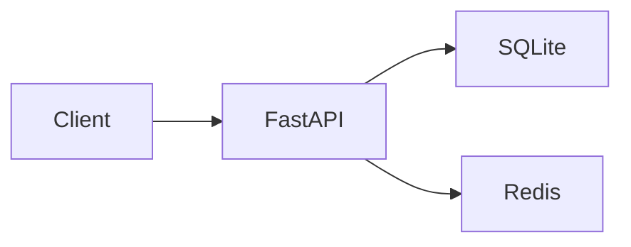

# URL shortener

A small Python API for creating and resolving short links. FastAPI handles the HTTP contract, SQLite stores links, and Redis is an optional cache.

## Run

```sh
python -m pip install -r requirements
python -m uvicorn app:app --host localhost --port 8003
```

Open http://localhost:8003/docs for the interactive API. The static UI in `frontend/` expects the API on this port.
Startup creates missing database tables. Runtime data defaults to `.data/links.db`; the historical committed database is not loaded automatically.

```sh
curl -X POST http://localhost:8003/get_short -H "Content-Type: application/json" -d '{"url":"https://example.com"}'
```

The response contains `short_url`. Visiting it redirects to the original URL. Invalid input returns 422, an unknown identifier returns 404, and a hash collision returns 409 without replacing the original destination.

## Design



The database write happens before the cache write. Redis failure falls back to the database. Repeated creation of the same URL is idempotent; a conflicting destination cannot overwrite an existing identifier.

## Configuration

Use environment variables or a local `.env`:

- `DATABASE_URL`: async SQLAlchemy URL; default `sqlite+aiosqlite:///.data/links.db`.
- `REDIS_URL`: default `redis://localhost:6379/0`.
- `EXP_TIME`: cache TTL in seconds, default 3600; this does not expire stored links.
- `SHORT_ID_LENGTH`: 1–32, default 7. Identifiers are deterministic truncated hashes, not access-control tokens.

Existing databases are not migrated automatically. Back up a database before explicitly selecting it.

## Validation

```sh
python -m pip install pytest-asyncio==1.2.0 httpx==0.28.1
python -m pytest -q tests
```

Tests use a temporary SQLite file and mocked cache/network boundaries. They cover the HTTP round trip, invalid input, repeated and concurrent writes, identifier conflicts, persistence failure and cache outages. No working database is cleared by the test suite.

## Scope and limitations

This is a local learning service. It has no public-service abuse controls, user authentication, custom aliases, hit statistics or Docker deployment. Only the SQLite configuration is exercised by the tests. Redis behavior is checked at its client boundary; a live Redis integration test is not included.
